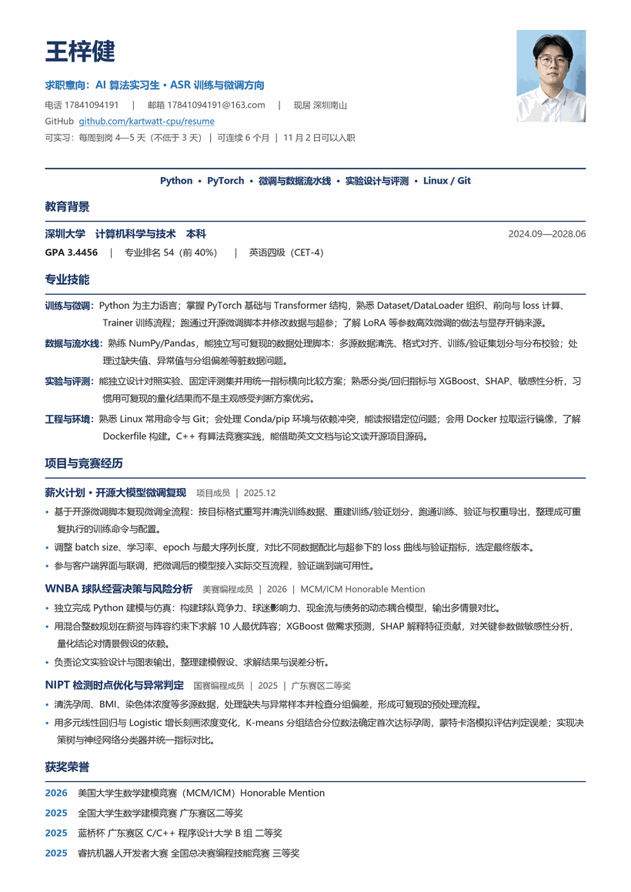

# 王梓健 · 简历与证书

深圳大学 计算机科学与技术（2024.09–2028.06）｜ 求职方向：**AI 算法实习（ASR 训练与微调）** · 数据 / 后端

一个单页简历 + 获奖与认证证书。证书已做脱敏处理：身份证号、准考证号、证书编号、二维码均已遮盖，同队成员姓名已模糊处理，原件可在面试时提供核验。

---

## 简历

- 📄 [王梓健 · AI 算法实习（ASR 训练与微调方向）](resume/Wang-Zijian-Resume-AI-Algorithm-Intern.pdf)

## 技能关键词

`Python` `PyTorch` `LLM 微调 / LoRA` `数据流水线` `实验设计与评测` `Linux` `Git` `Docker` `C++` `NumPy / Pandas` `XGBoost` `SHAP`

## 教育与获奖

| 时间 | 项目 | 结果 |
| --- | --- | --- |
| 2024.09–2028.06 | 深圳大学 · 计算机科学与技术（本科） | GPA 3.4456 ｜ 专业排名 54（前 40%） |
| 2026 | 美国大学生数学建模竞赛（MCM/ICM） | Honorable Mention |
| 2025 | 全国大学生数学建模竞赛 广东赛区 | 二等奖 |
| 2025 | 第十六届蓝桥杯 广东赛区 C/C++ 程序设计大学 B 组 | 二等奖 |
| 2025 | 睿抗机器人开发者大赛（RAICOM）全国总决赛 编程技能竞赛 | 三等奖 |
| 2025 | 睿抗机器人开发者大赛（RAICOM）广东赛区 编程技能竞赛 | 二等奖 |
| 2025 | 华为 HarmonyOS 应用开发者基础认证 | 通过（有效期至 2027.07） |
| 2025.06 | 全国大学英语四级考试（CET-4） | 467 分 |

## 证书

| 文件 | 说明 |
| --- | --- |
| [2026-MCM-ICM-Honorable-Mention.png](certificates/2026-MCM-ICM-Honorable-Mention.png) | 美赛 H 奖（Honorable Mention） |
| [2025-Guangdong-Math-Modeling-2nd.png](certificates/2025-Guangdong-Math-Modeling-2nd.png) | 广东省大学生数学建模竞赛 二等奖 |
| [2025-Lanqiao-Cup-Provincial-2nd.jpg](certificates/2025-Lanqiao-Cup-Provincial-2nd.jpg) | 蓝桥杯 广东赛区 C/C++ B 组 二等奖 |
| [2025-RAICOM-National-3rd.jpg](certificates/2025-RAICOM-National-3rd.jpg) | 睿抗 全国总决赛 三等奖 |
| [2025-RAICOM-Guangdong-2nd.jpg](certificates/2025-RAICOM-Guangdong-2nd.jpg) | 睿抗 广东赛区 二等奖 |
| [2025-HarmonyOS-Developer-Basic.jpg](certificates/2025-HarmonyOS-Developer-Basic.jpg) | 华为 HarmonyOS 应用开发者基础认证 |
| [2025-CET4-Score-Report.jpg](certificates/2025-CET4-Score-Report.jpg) | 大学英语四级成绩报告单 |

## 联系方式

- 邮箱：17841094191@163.com
- 电话：见简历 PDF
- 现居：深圳市南山区

